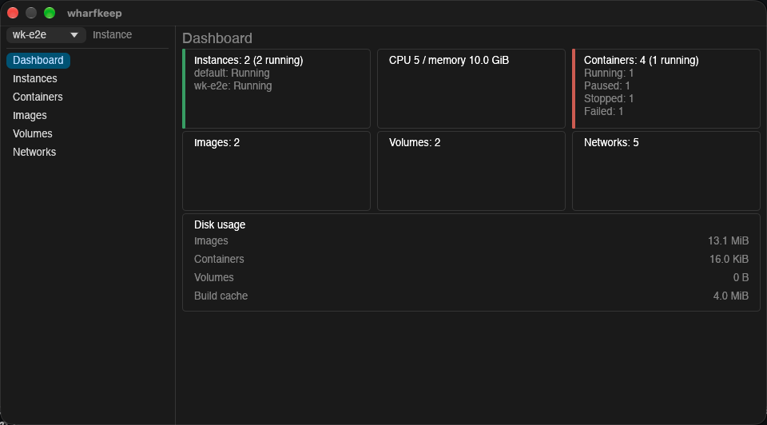
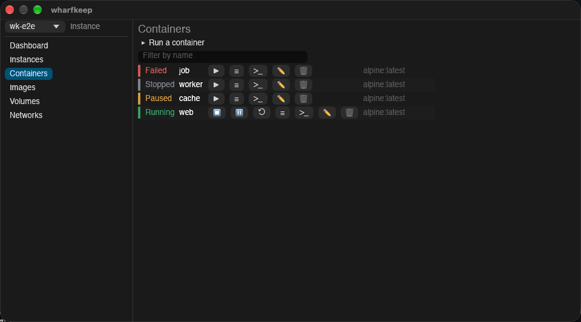
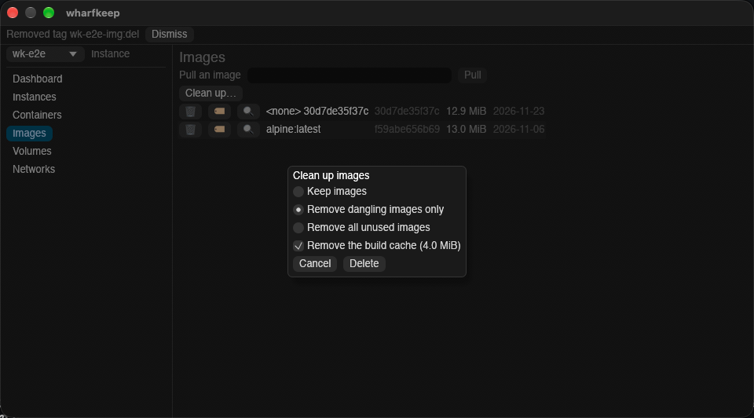

# wharfkeep

[](https://github.com/okamyuji/wharfkeep/actions/workflows/ci.yml)
[](https://github.com/okamyuji/wharfkeep/releases/latest)
[](LICENSE)

A macOS menu bar app for watching and controlling [Colima](https://github.com/abiosoft/colima) and its Docker containers, written in Rust.

wharfkeep runs as two processes. A small daemon stays in the menu bar and keeps watching Colima and Docker. The window is a separate process that starts only when you open it and exits when you close it, so it holds no memory while hidden.

## Screenshots

The dashboard. The bar on the left of a card turns coral when a container failed to start.



The container list. Each row has its own start, stop, pause, restart, logs, shell, rename and delete buttons, and a status bar on the left.



Cleaning up images. Every delete asks for confirmation first.



## Features

- Menu bar icon that shows the overall state at a glance:
  - coral when a container failed to start (it keeps restarting, is dead, was killed for running out of memory, or exited with an error code),
  - dark blue when everything is fine, including containers you stopped yourself,
  - pale blue when no Colima instance is running.
- Start and stop Colima instances from the menu bar.
- Change things from the window: run, rename and delete containers, create and delete Colima instances, and delete or clean up images, volumes, networks and the build cache. A confirmation dialog appears before anything is deleted.
- Watches containers, images, volumes, networks and disk usage through the Docker Engine API of each running instance.
- Starts at login through a launchd LaunchAgent. You can turn this off from the menu bar.
- English and Japanese. The language follows the macOS language setting.

## Requirements

- macOS
- [Colima](https://github.com/abiosoft/colima), installed with Homebrew or on your `PATH`
- Rust 1.100 or later to build from source (`rust-toolchain.toml` pins the toolchain)

## Installation

There are two ways to install: the zip of a GitHub release, or a build from source. Both put the app at `/Applications/wharfkeep.app`.

### From a release

Download `wharfkeep-<version>-macos-arm64.zip` from the [latest release](https://github.com/okamyuji/wharfkeep/releases/latest), unzip it, and move `wharfkeep.app` to `/Applications`. The app is ad-hoc signed and not notarized. If macOS blocks it, run:

```sh
xattr -dr com.apple.quarantine /Applications/wharfkeep.app
```

The first launch registers the app in `/Applications` to start at login. If an older copy is already running, choose **Quit** from its menu bar item before you open the new one.

From a clone of this repository, `cargo xtask install` does the same with the [GitHub CLI](https://cli.github.com/) (`gh`). It downloads the zip of the latest release, stops the running daemon, replaces `/Applications/wharfkeep.app`, and starts the new app. It then checks that launchd runs the daemon from `/Applications` and that the login item points there, and exits with an error that names the problem when either check fails. It stops before touching the running daemon when it cannot write to `/Applications`.

When a push to `main` passes CI and the version in `Cargo.toml` has no release yet, CI builds the app and publishes that version as a new release.

### Build from source

```sh
git clone https://github.com/okamyuji/wharfkeep.git
cd wharfkeep
cargo xtask install --local
```

`cargo xtask install --local` builds the app bundle with `cargo xtask bundle --no-bump` and installs it the same way as a release.

`cargo xtask bundle` builds `target/wharfkeep.app`. It stamps the bundle with the version in `Cargo.toml` plus the commit it was built from, such as `0.1.1+local.abc1234` (`.dirty` is added when files other than `Cargo.toml` and `Cargo.lock` are changed or untracked; `nogit` replaces the commit outside a Git checkout of this repository). Only the CI release build (`cargo xtask bundle --release`, refused outside GitHub Actions) carries the bare version, so a local build never looks like a release. After building, `cargo xtask bundle` raises the patch number in `Cargo.toml` and `Cargo.lock` for the next build. Add `--no-bump` to build without raising the version, for example before `cargo xtask e2e`.

### Uninstall

```sh
cargo xtask uninstall
```

This stops the daemon and the window, and removes `/Applications/wharfkeep.app` and the login item `~/Library/LaunchAgents/wharfkeep.plist`. It keeps your settings and state in `~/Library/Application Support/work.okamyuji.wharfkeep/` and prints that location. Without a clone, choose **Quit** from the menu bar item, then delete those two files yourself.

## Usage

The menu shows one item per Colima instance, such as **Start default** or **Stop default**. It also has **Open Window**, **Start at Login** and **Quit**.

The app bundle runs the daemon by default. You can also run each part from a terminal:

```sh
/Applications/wharfkeep.app/Contents/MacOS/wharfkeep daemon   # menu bar item and monitoring
/Applications/wharfkeep.app/Contents/MacOS/wharfkeep gui      # window
```

In the window you can run and rename containers, create and delete instances, and delete or clean up images, volumes, networks and the build cache. Every delete asks for confirmation first.

Only one daemon and one window run at a time. A binary run from outside an app bundle, such as `target/debug/wharfkeep`, leaves the login item unchanged.

### Configuration

| Environment variable | Values | Effect |
|---|---|---|
| `WHARFKEEP_LANG` | `en`, `ja` | Overrides the language taken from macOS. |
| `WHARFKEEP_PROFILE` | colima instance name | Selects this instance when the window opens. `cargo xtask e2e` uses it to run on a dedicated instance. |

### Files

wharfkeep keeps its state in `~/Library/Application Support/work.okamyuji.wharfkeep/`, readable only by you. The login item is `~/Library/LaunchAgents/wharfkeep.plist`. If either file is a symbolic link, wharfkeep replaces the link with a regular file when it writes.

## Development

```sh
cargo test --workspace --locked
cargo clippy --workspace --all-targets --locked -- -D warnings
cargo fmt --check
cargo deny check licenses
```

Tests that need a running Colima instance or open a Terminal window are ignored by default. Run them with `cargo test -- --ignored`.

`cargo xtask e2e` tests the bundle that `cargo xtask bundle --no-bump` built. It launches the app the way macOS does, uses the menu bar through the Accessibility API, opens and closes the window, and checks the state file and screenshots. It needs Accessibility and Screen Recording permission for your terminal and a running Colima instance named `default`. It stops with an error when the screen is locked or when port 8080 is in use. It creates an instance named `wk-e2e` for the delete and cleanup checks and deletes it at the end; it stops when an instance with that name already exists. In `wk-e2e` it pulls `nginx:alpine` from the window, runs it as `wk-e2e-web` with port `8080:80`, checks that `localhost:8080` answers 200, opens its logs and a shell in the terminal app (closing that Terminal window afterwards), and deletes the container. It stops `default` once and starts it again. In `default` it pulls `alpine:latest` if missing and runs a container named `wk-e2e-row`, removing any existing container with that name first and again at the end. It resets wharfkeep's own settings. It changes the login item while it runs; at the end, if `/Applications/wharfkeep.app` exists, it starts that app once so that the login item points to it again. `E2E_LIMIT` sets the overall time limit in seconds (1500 by default), and `WHARFKEEP_E2E_FRONT_APP` names the app on the external display that it brings to the front before it uses the menu bar (Zed by default).

## License

[MIT](LICENSE)
